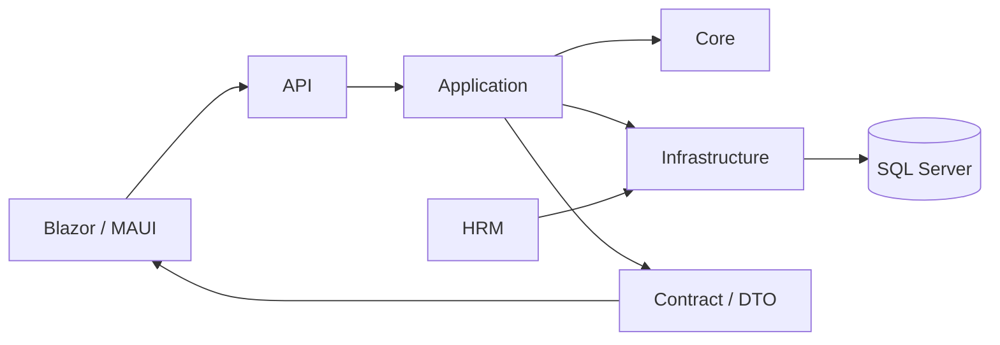

# FVN_REGISTER

FVN_REGISTER là nền tảng đăng ký nghiệp vụ nhân sự và phê duyệt điện tử, bao gồm Nghỉ phép, Làm thêm giờ (OT), Công tác, Thiết bị, Chấm công/Đối soát, Lịch làm việc, Trung tâm công việc, Thông báo, Bảng điều khiển, Báo cáo và năng lực IT về kiểm kê/tuân thủ máy Windows (Endpoint) theo phạm vi triển khai. Mức sẵn sàng từng nghiệp vụ phải được xác nhận theo hướng dẫn trong bộ tài liệu Ban giám đốc.

## Bộ tài liệu giới thiệu và đánh giá hiệu quả

- **Cổng tài liệu giới thiệu:** [Bộ tài liệu Ban giám đốc](M%C3%94%20H%C3%8CNH/03_TAI_LIEU_HE_THONG/01_GIOI_THIEU/00_README.md)
- [Giới thiệu tổng thể](M%C3%94%20H%C3%8CNH/03_TAI_LIEU_HE_THONG/01_GIOI_THIEU/01_INTRODUCTION.md)
- [Trình chiếu Ban giám đốc](M%C3%94%20H%C3%8CNH/03_TAI_LIEU_HE_THONG/01_GIOI_THIEU/04_PRESENTATION.md)
- [Bản đồ tính năng và giá trị](M%C3%94%20H%C3%8CNH/03_TAI_LIEU_HE_THONG/01_GIOI_THIEU/02_FEATURES.md)
- [Lợi ích theo vai trò](M%C3%94%20H%C3%8NH/03_TAI_LIEU_HE_THONG/01_GIOI_THIEU/06_ROLE_BENEFITS.md)
- [Kịch bản demo](M%C3%94%20H%C3%8NH/03_TAI_LIEU_HE_THONG/01_GIOI_THIEU/07_DEMO_STORYBOARD.md)
- [Kiểm soát sẵn sàng và tuyên bố chức năng](M%C3%94%20H%C3%8NH/03_TAI_LIEU_HE_THONG/01_GIOI_THIEU/08_READINESS_AND_CLAIMS.md)
- [Đánh giá hiệu quả đầu tư](M%C3%94%20H%C3%8NH/03_TAI_LIEU_HE_THONG/01_GIOI_THIEU/09_BUSINESS_CASE_COST_REDUCTION.md)

## Tài liệu sản phẩm và kỹ thuật

- **Tài liệu kiến trúc/source of truth:** [24 — Work Calendar & Action](M%C3%94%20H%C3%8CNH/01_KIEN_TRUC_HE_THONG/24_WORK_CALENDAR_AND_ACTION_IMPLEMENTATION.md)
- **Đối soát thực tế:** [18 — Reconciliation](M%C3%94%20H%C3%8CNH/01_KIEN_TRUC_HE_THONG/EXECUTION/18_OT_ATTENDANCE_RECONCILIATION.md)
- **Cổng tài liệu:** [Documentation](M%C3%94%20H%C3%8CNH/03_TAI_LIEU_HE_THONG/00_DOCUMENTATION_INDEX.md)
- **Hướng dẫn người dùng:** [User Guide](M%C3%94%20H%C3%8CNH/03_TAI_LIEU_HE_THONG/02_HUONG_DAN_SU_DUNG/04_USER_GUIDE.md)
- **Hướng dẫn nhanh:** [Quick Guide](M%C3%94%20H%C3%8CNH/03_TAI_LIEU_HE_THONG/02_HUONG_DAN_SU_DUNG/05_QUICK_GUIDE.md)
- **Câu hỏi thường gặp:** [FAQ](M%C3%94%20H%C3%8CNH/03_TAI_LIEU_HE_THONG/02_HUONG_DAN_SU_DUNG/06_FAQ.md)
- **Chuẩn tài liệu:** [Documentation Standard](M%C3%94%20H%C3%8CNH/03_TAI_LIEU_HE_THONG/05_TIEU_CHUAN_TAI_LIEU/08_DOCUMENTATION_STANDARD.md)

## Nền tảng AI — thiết kế và lộ trình

- **Cổng tài liệu AI:** [AI Platform Documentation Index](docs/AI_PLATFORM_DOCUMENTATION_INDEX.md)
- [Kiến trúc hiện tại FVN AI](docs/AI_PLATFORM_ARCHITECTURE.md)
- [Trạng thái triển khai Phase 1–6 — canonical](AI_PLATFORM_PHASES_STATUS.md)
- [Vận hành AI Platform — migration 001–014, backup/restore, monitoring và cost](docs/AI_PLATFORM_OPERATIONS.md)
- [Thiết kế HR Policy Assistant — hỏi đáp quy định nhân sự](docs/AI_HR_POLICY_ASSISTANT.md)
- [Thiết kế triển khai HR Case Assistant — bằng chứng, dữ liệu chính thức và HR duyệt](docs/AI_HR_CASE_ASSISTANT_IMPLEMENTATION.md)
- [Pilot AI phân tích bằng chứng và đối soát HR](docs/AI_HR_RECONCILIATION_PILOT.md)

FVN AI là bounded context độc lập. FVN_REGISTER giữ quyền xác thực/RBAC, dữ liệu nghiệp vụ và các thao tác ghi. HR Policy Assistant chỉ trả lời theo phiên bản quy định đã được HR phê duyệt, đang có hiệu lực và phù hợp phạm vi người hỏi; mọi câu trả lời cần dẫn nguồn điều/khoản/trang. Tài liệu thiết kế phải phân biệt rõ phần đã có trong mã nguồn với phần còn trong backlog.

## Cấu hình và bảo mật AI

AI API yêu cầu migration `SQL/AI/011_Persistent_Request_Replay_Protection.sql` và migration `014_Phase5_ReleaseRetentionTenantHardening.sql`. Đặt `AIPlatform:ContextSigningKey` tối thiểu 32 ký tự và dùng cùng secret với gateway tin cậy.

`AIPlatform:RequireContentBoundSignatures` mặc định là `true`; infrastructure từ chối khởi động nếu cấu hình bị tắt. Khi bật, signer phải ràng buộc HTTP method, path + query, tenant, actor, timestamp, nonce và SHA-256 raw body. Vì vậy `moduleCode`/`schemaCode` của multipart và `CorrectedPayloadJson` của review không thể bị thay đổi mà vẫn qua HMAC.

## Ranh giới kiến trúc

### Lịch làm việc chung

Nghỉ phép, OT và Công tác sử dụng góc nhìn lịch làm việc chung. Lịch là projection/navigation, không sở hữu trạng thái nghiệp vụ gốc.

- `GET /api/calendar`
- `GET /api/calendar/availability`
- UI: `WorkCalendar`
- Rule contract: `CalendarDayDto` + `ICalendarDayRule`
- Chi tiết: `MÔ HÌNH/24_WORK_CALENDAR_AND_ACTION_IMPLEMENTATION.md`

### Báo cáo và thống kê

Báo cáo nghiệp vụ chịu kiểm soát theo capability và phạm vi dữ liệu. Quyền xem và quyền xuất dữ liệu là hai quyền riêng biệt.

### Nghỉ phép / OT / Công tác

Đây là các nghiệp vụ yêu cầu riêng với kiểm tra điều kiện, đăng ký, phê duyệt và lịch sử. Yêu cầu đã được duyệt là kế hoạch; actual được lấy từ nguồn thực tế chính thức và đối soát phù hợp.

> AI Phase 5 hardening baseline: migration 014 + release-bound provenance + release-scoped golden evaluations + retention/knowledge purge + dead-letter document state + mandatory content-bound signatures.