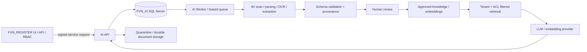

# FVN_REGISTER AI Platform — Operations Runbook

This runbook is for the dedicated `FVN_AI` database and the `feature/ai-platform-phase1-6` implementation. It is not a claim that production operations have already been exercised.

## Architecture at a glance

FVN_REGISTER remains the authority for identity, RBAC, official HR data, approvals and business writes. AI-generated content is a candidate, not a business decision. The production authorization adapters for Phase 3–5 are still incomplete.

## Configuration and secrets

Supply settings through environment variables, .NET user-secrets in development, or an approved secret manager in production. Never commit secret values.

| Setting / secret | Purpose | Handling |
|---|---|---|
| `ConnectionStrings__DefaultConnection` | Dedicated FVN_AI SQL Server connection | Least-privilege SQL login; TLS; rotate credentials |
| `AIPlatform__ContextSigningKey` | HMAC key shared with trusted FVN_REGISTER gateway | At least 32 random characters; keep identical only across trusted signer/API; rotate via coordinated rollout |
| `AIPlatform__RequireContentBoundSignatures` | Binds signature to path+query and SHA-256 body | Keep false until gateway signer implements matching canonicalization; then enable together |
| `AIPlatform__ApiKey` (if configured) | Service/API authentication | Secret manager; separate per environment |
| `AIPlatform__DefaultProvider`, `Endpoint`, `Model` | Chat provider/model (currently local Ollama supported) | Restrict network egress; pin model/version |
| `AIPlatform__EmbeddingModel` and embedding endpoint/provider settings | Embedding provider/model | Version embeddings and plan re-indexing before model changes |
| `AIPlatform__Ocr__TesseractExecutable`, `PdfToPpmExecutable`, `Languages`, `Dpi`, `TimeoutSeconds` | OCR executables, languages and limits | Install binaries/language packs on API/Worker hosts; test file size/timeouts |
| Storage root / malware scanner configuration | Durable originals, quarantine and AV verdicts | Shared durable storage for all replicas; encrypt at rest; scanner must fail closed |
| ASP.NET/Kestrel upload limits | Maximum accepted upload and multipart body | Keep proxy, Kestrel and application limits aligned |

Confirm exact configuration binding against the deployed `AIPlatformOptions` before release; do not assume optional keys are active merely because they are listed here.

## Migration sequence, ledger and drift

For an empty dedicated database, apply `SQL/AI/001_...` through `SQL/AI/012_...` in numeric order. Do not run these migrations against the FVN_REGISTER operational database.

- Migration 012 moves the knowledge-chunk ordinal unique index into a new forward migration. Historical migrations 003 and 005 must not be edited in released environments; the repository now leaves that index to 012 so new and existing databases converge.
- Migration 010 introduced the ledger. Migration 012 adds `MigrationFileName` and `Sha256Checksum`. A NULL checksum means the file was applied before checksum tracking or its exact source could not be verified; do not label it checksum-verified.
- Use `scripts/apply-ai-migrations.sh` for deployments. It checks known checksums before applying and registers checksum metadata where it can safely verify the file. Run it once for deployment; CI invokes it twice to exercise repeatability.
- Back up the database and verify restore before production migration. Take a schema/data snapshot or tested full backup, record current migration rows, and rehearse on a restored copy.
- Do not edit a migration already applied to any shared environment. Add a new numbered migration and update the runner/workflow list instead.
- Migration 012 fails if duplicate `(TenantCode, DocumentId, ChunkOrdinal)` rows exist. Reconcile duplicates explicitly; never delete knowledge or audit records automatically as a generic migration side effect. Migration 013 fixes HR case text-column lengths; its clean-install predecessor had invalid `NVARCHAR(8000)` declarations, which SQL Server rejects.

## Rollback and recovery

SQL schema changes are not generally rolled back by replaying old scripts. The default recovery is **forward-fix**:

1. Stop AI API/Worker writes and pause queue consumers.
2. Take a fresh backup and preserve migration ledger, application logs and affected document IDs.
3. Restore the last verified backup to a separate database and validate it before any cutover.
4. If only the newest migration is faulty and no dependent writes occurred, use a reviewed, migration-specific rollback script on a clone first. Do not drop columns/tables or unique indexes blindly.
5. Prefer a new corrective migration for production; deploy code compatible with both old/new schema during rollout.
6. Resume workers gradually and verify queue depth, failures, extraction counts, tenant boundaries and audit trails.

Migration 012's unique index can be removed as a narrowly scoped rollback only after assessing duplicate creation and application dependencies. No automatic destructive rollback is provided.

## Backup and restore

- Use SQL Server full backups plus differential/log backups according to the site's RPO/RTO; include encryption and off-host/offline retention.
- Back up document/object storage separately and preserve its mapping to `StorageKey`; a SQL-only restore is incomplete if originals are missing.
- Back up model/prompt/schema configuration and secret-manager references (never secret plaintext in the backup manifest).
- Periodically restore SQL and document storage together into an isolated environment. Verify document hashes, tenant ownership, schema versions, reviews, knowledge chunks, queue leases and ability to reprocess.
- Define and record RPO/RTO with the system owner before production sign-off.

## Metrics and structured logs

Emit structured logs with correlation/request ID, tenant identifier (not personal payload), document/job ID, provider/model/version, duration, retry count and failure code. Never log raw HR evidence, document bodies, prompts containing PII, signing keys or API tokens.

At minimum monitor:

- Queue depth by status, oldest queued age, active/expired leases, retries and dead-letter count.
- Ingestion accepted/rejected/quarantined count and malware scanner timeout/failure.
- Extraction/validation duration, schema-not-found, issue counts and human-review backlog/age.
- Embedding tokens/items, embedding latency/errors, indexed chunk count and re-index jobs.
- LLM input/output tokens, latency, timeout/rate-limit/error rate, abstention/citation failure rate.
- Per-tenant request counts, authorization denials, replay-signature denials and cross-tenant access test failures.
- SQL CPU/IO, query duration, connection pool pressure, storage growth and backup/restore age.

Alert on sustained queue age, dead letters, repeated provider failures, abnormal cost/token spikes, missing backups and any authorization/tenant-boundary regression. Keep retention bounded and avoid high-cardinality personal identifiers in metric labels.

## Embedding and LLM cost model

Local Ollama has no per-token provider invoice, but it is not zero-cost: GPU/CPU time, RAM/VRAM, power, storage, model operations and capacity opportunity cost must be measured. Hosted providers may bill input/output tokens and embedding tokens, plus storage, reranking, OCR, network and retry overhead.

Track monthly by tenant and model:
- Chat cost = input tokens × input rate + output tokens × output rate (for hosted providers).
- Embedding cost = embedded tokens × embedding rate; count initial indexing and re-indexing separately.
- Total operating cost = hosted inference + compute amortization + storage + OCR/AV + monitoring/backup + operator time.

Use model/token budgets, max document size/page count, request rate limits, embedding deduplication by content hash, caching where policy allows, and alerts on re-indexing loops. Prices/rates are provider- and model-specific; fetch current rates from the selected provider at deployment time rather than hard-coding them here.

## Tenant isolation and defense in depth

Application queries and stored procedures that serve a tenant must include an explicit tenant predicate and use tenant context derived from the trusted gateway, not from client-supplied filters. Queue claim/recovery procedures are intentionally cross-tenant schedulers; they may claim any queued job but must not return document contents or grant user access.

The current SQL Server CI suite checks tenant-scoped duplicate protection, guards the RAG vector query for both chunk and review tenant/document identity, and rejects newly added tenant-sensitive stored procedures that contain no `TenantCode` reference unless they are on the explicit queue-scheduler allowlist. This is a useful guard, **not proof that every EF/LINQ query in every endpoint is tenant-safe**; complete endpoint-by-endpoint integration tests and code review remain a release gate. Row-Level Security (RLS) is a possible second layer, but should only be enabled after the platform sets `SESSION_CONTEXT` on every connection, resets it safely with pooling, and tests background-worker semantics. RLS is not currently claimed as enabled.
